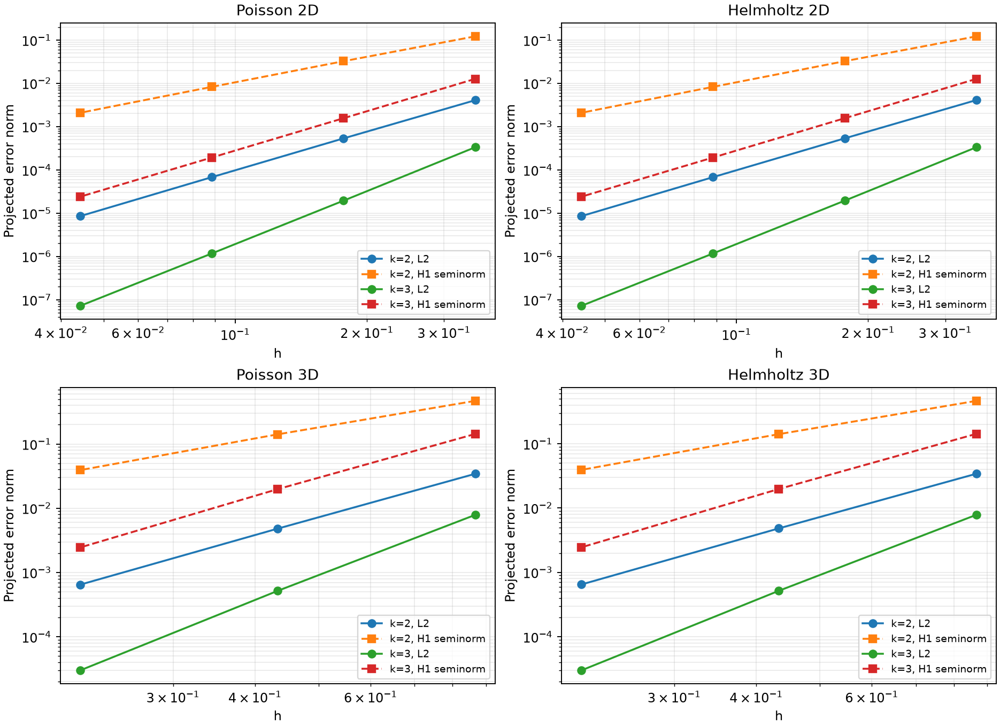
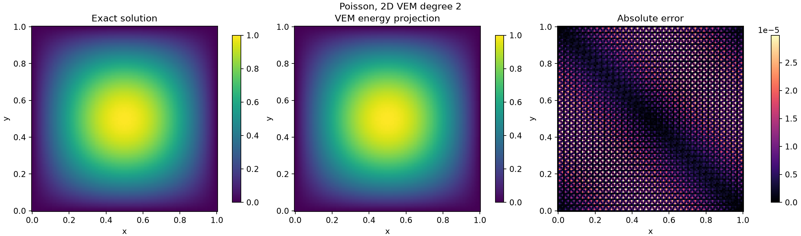
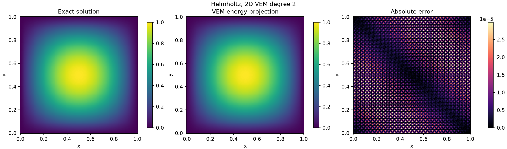
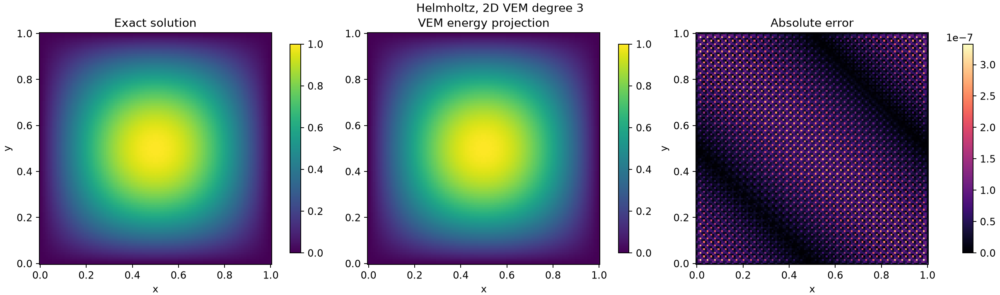
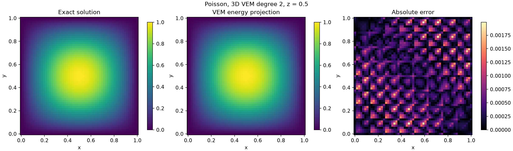
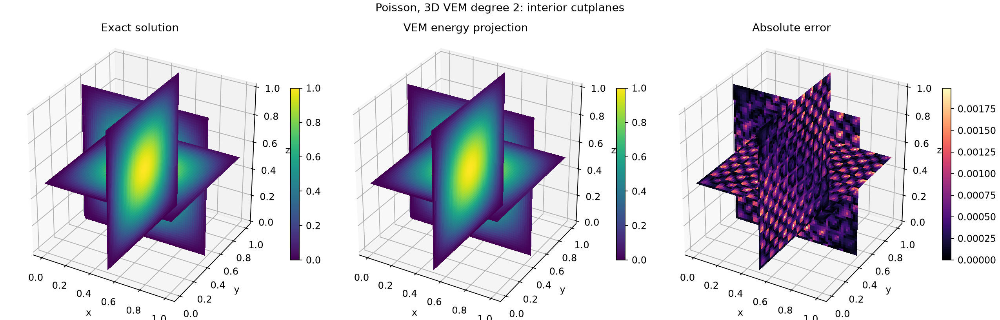
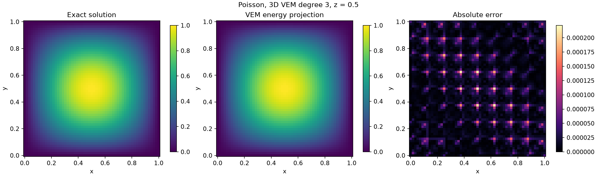
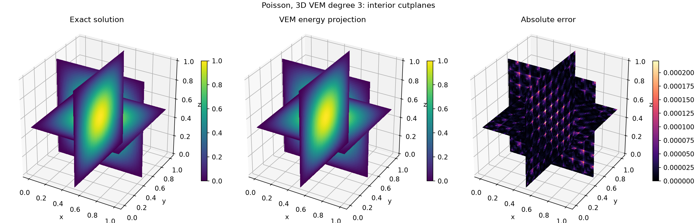
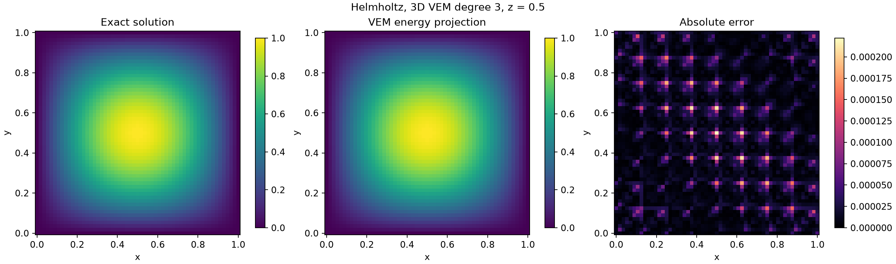
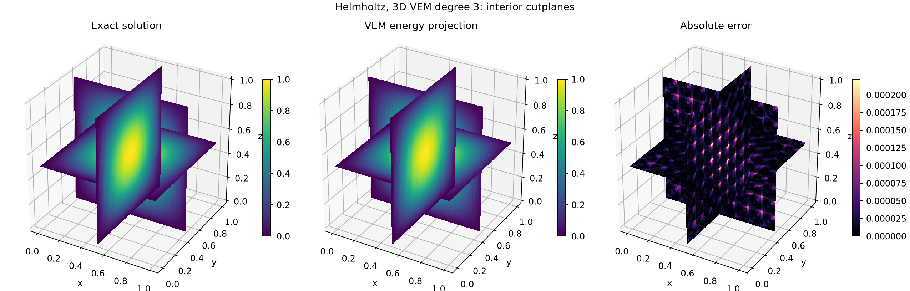

# 高阶 VEM 运行结果

验证记录：通过 128，失败 0（`python tests/run_tests.py`）。

运行命令：`python examples/vem_high_order_demo.py`。

## 算例与框架

二维沿用指导书和 `examples/poisson_demo.py`：单位正方形，`u=sin(pi*x)sin(pi*y)`，齐次 Dirichlet 边界。三维沿用 `tests/run_checks.py`：单位立方体，`u=sin(pi*x)sin(pi*y)sin(pi*z)`。

Poisson 为 `-Delta u=f`，`f=d*pi^2*u`；Helmholtz 为 `-Delta u-wave_number^2*u=f`，波数保持指导书的 1，`f=(d*pi^2-1)*u`。三维 Helmholtz 在原三维正弦算例上采用同一方程，未替换精确解、区域或边界。这里 k 表示离散多项式次数，不是波数。

原有 core → spaces → physics → solvers → postprocess 分层不变。调用仍为 `FESpace.vem(mesh, degree=k)`，物理类和求解接口不变。支持任意整数 k>=1，k=1 保留原路径；本报告验证并运行 k=2、3。

## 方法与代码阅读

- `core/mesh.py`：网格、边界面与几何；`core/quadrature.py`：积分。高阶单纯形规则已补齐，避免把三/四阶规则当成任意高阶规则。
- `spaces/vem.py`：二维能量投影、稳定化、刚度、质量、载荷和重构。自由度是顶点值、每条边 k-1 个内部点值、次数 <=k-2 的归一化单元矩。
- `spaces/vem_high.py`：三维增加共享面矩和体矩，面迹递归构造二维增强 VEM。同一面使用统一的局部坐标和自由度方向；面矩边界条件按积分赋值。
- 能量投影由分部积分计算，并用已知单元均值固定常数。增强约束提供 k-1、k 次矩，低次矩使用真实自由度，构造完整 L2 投影。质量矩阵为投影质量加核空间稳定化；载荷为 L2 投影载荷。
- `physics/poisson.py` 与 `physics/helmholtz.py`：继续组合空间矩阵，直接法解稀疏方程；`postprocess/error.py`：数值积分误差。矩自由度不是点值，已从点值 Linf 比较中排除。

### 与指导书一阶实现的对应关系

设 D 是多项式到自由度的矩阵，B 是多项式梯度 Gram 矩阵，H 是多项式质量矩阵。高阶仍沿用指导书的“一致性项 + 稳定化项”：

`B Pi = R`，其中 `R[alpha,i] = integral_boundary(phi_i * dn(m_alpha)) - integral_cell(phi_i * Delta(m_alpha))`；常数模式用单元均值补足。

`K_local = Pi.T B Pi + sigma (I-D Pi).T (I-D Pi)`；`M_local = Pi0.T H Pi0 + |K| (I-D Pi0).T (I-D Pi0)`；`b_local = Pi0.T [integral_cell(f*m_alpha)]`。

二维单元自由度数为 `Nv + Ne*(k-1) + k*(k-1)/2`；三维为 `Nv + Ne*(k-1) + Nf*k*(k-1)/2 + (k+1)*k*(k-1)/6`。例如三阶四面体每单元 32 个局部自由度；共享顶点、边和面自由度后，全局自由度数小于局部数之和。

## 最细网格结果

| 问题 | 维数 | k | n | 单元数 | 自由度 | L2 | H1 半范数 | 采样 Linf | 相对残差 |
|---|---:|---:|---:|---:|---:|---:|---:|---:|---:|
| poisson | 2 | 2 | 32 | 2048 | 6273 | 8.529905e-06 | 2.085019e-03 | 2.410301e-05 | 1.05e-12 |
| poisson | 2 | 3 | 32 | 2048 | 13505 | 7.204298e-08 | 2.397632e-05 | 3.244996e-07 | 6.34e-12 |
| helmholtz | 2 | 2 | 32 | 2048 | 6273 | 8.531283e-06 | 2.085018e-03 | 2.410382e-05 | 1.09e-12 |
| helmholtz | 2 | 3 | 32 | 2048 | 13505 | 7.204278e-08 | 2.397587e-05 | 3.244992e-07 | 6.84e-12 |
| poisson | 3 | 2 | 8 | 3072 | 14513 | 6.470101e-04 | 3.919794e-02 | 2.880104e-03 | 2.07e-13 |
| poisson | 3 | 3 | 8 | 3072 | 40969 | 2.998201e-05 | 2.452564e-03 | 2.023846e-04 | 9.63e-12 |
| helmholtz | 3 | 2 | 8 | 3072 | 14513 | 6.482727e-04 | 3.918417e-02 | 2.878627e-03 | 2.09e-13 |
| helmholtz | 3 | 3 | 8 | 3072 | 40969 | 2.997138e-05 | 2.450982e-03 | 2.024773e-04 | 9.17e-12 |

## 最后两级网格收敛阶

| 问题 | 维数 | k | L2 阶（预期 k+1） | H1 阶（预期 k） |
|---|---:|---:|---:|---:|
| poisson | 2 | 2 | 2.993 | 1.991 |
| poisson | 2 | 3 | 4.024 | 3.009 |
| helmholtz | 2 | 2 | 2.994 | 1.991 |
| helmholtz | 2 | 3 | 4.024 | 3.009 |
| poisson | 3 | 2 | 2.897 | 1.850 |
| poisson | 3 | 3 | 4.112 | 3.015 |
| helmholtz | 3 | 2 | 2.899 | 1.847 |
| helmholtz | 3 | 3 | 4.111 | 3.013 |

## 误差与图的含义

VEM 内部基函数不显式可得，L2 和 H1 分别比较能量投影 `Pi^nabla_k u_h` 及其梯度与精确解，图也使用同一投影。报告的是可计算的投影误差，不能声称为虚拟函数本体的精确范数。Linf 是求积点、顶点和边节点上的采样最大误差，不是严格的连续上确界。

二维图包含精确解、数值投影解和绝对误差；三维同时提供 z=0.5 截面与 x/y/z=0.5 三个内部切面的空间云图。齐次边界上的解为零，因此不采用只展示外表面的云图。色标是实际数值，没有对误差进行归一化。

主运行保持已有三角形与四面体网格。高阶投影、刚度、质量与非零边界多项式 patch tests 还覆盖四边形和六面体；积分检验覆盖更高次数。

完整逐级数据见 [results.csv](results.csv)，最细网格的自由度、单元连接和投影系数保存在各个 NPZ 文件。

实现参考：[The Virtual Element Method, Acta Numerica 2023](https://iris.cnr.it/bitstream/20.500.14243/538888/1/the-virtual-element-method.pdf)，其中增强空间与三维递归面构造用于补充指导书的一阶方法。

### poisson 2D, k=2

### poisson 2D, k=3

### helmholtz 2D, k=2

### helmholtz 2D, k=3

### poisson 3D, k=2

### poisson 3D, k=3

### helmholtz 3D, k=2

### helmholtz 3D, k=3

